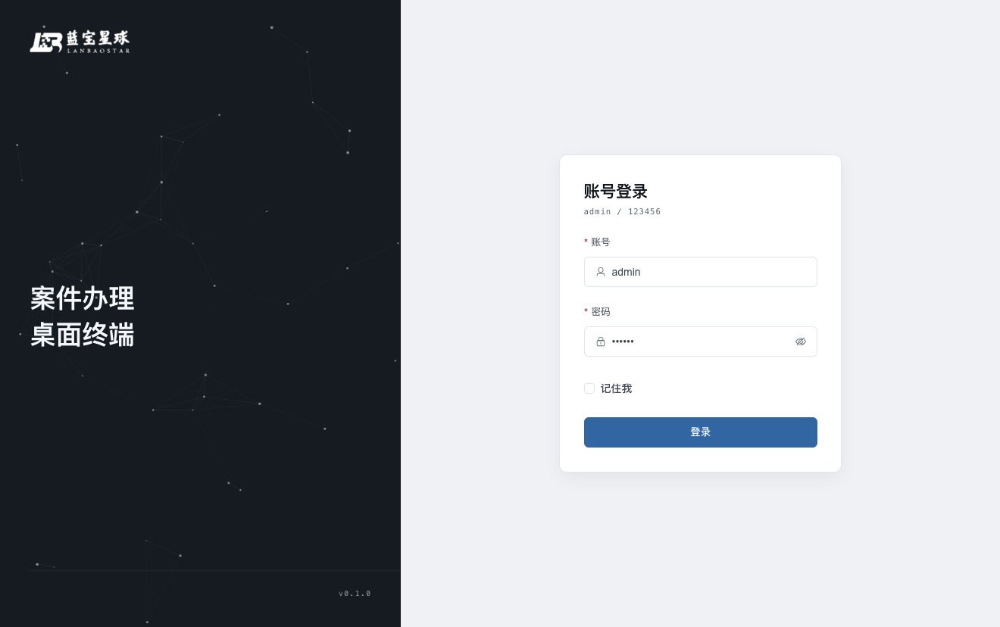
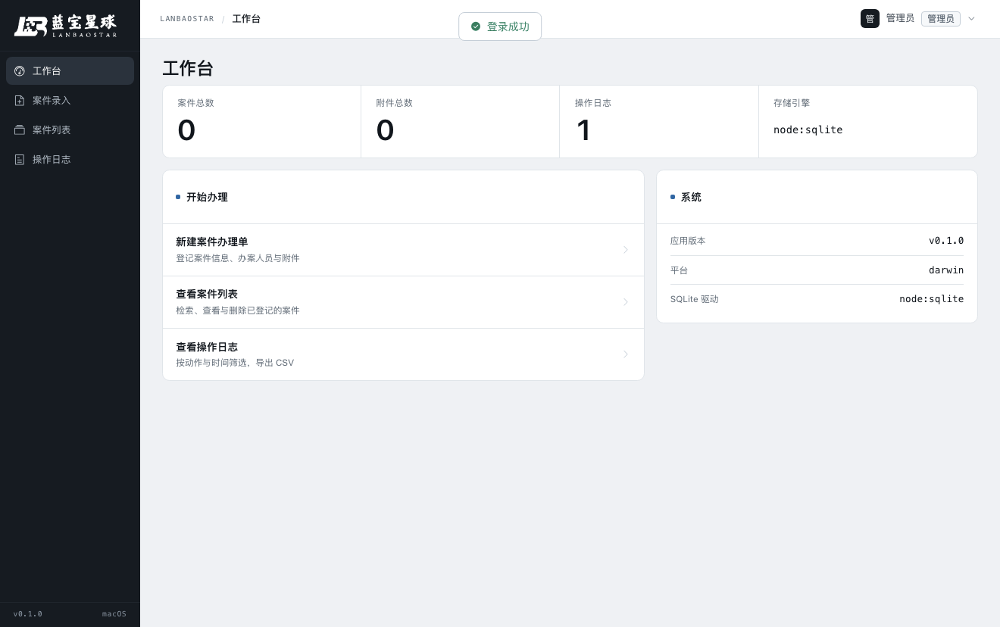
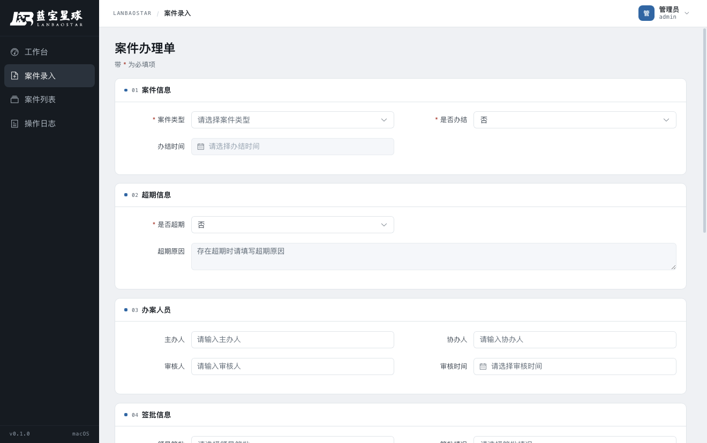
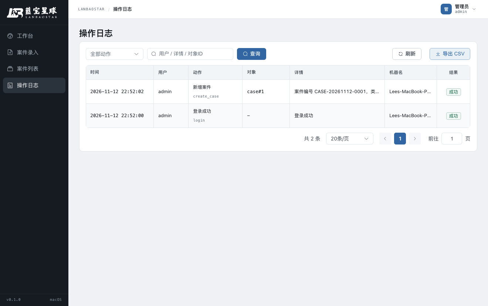
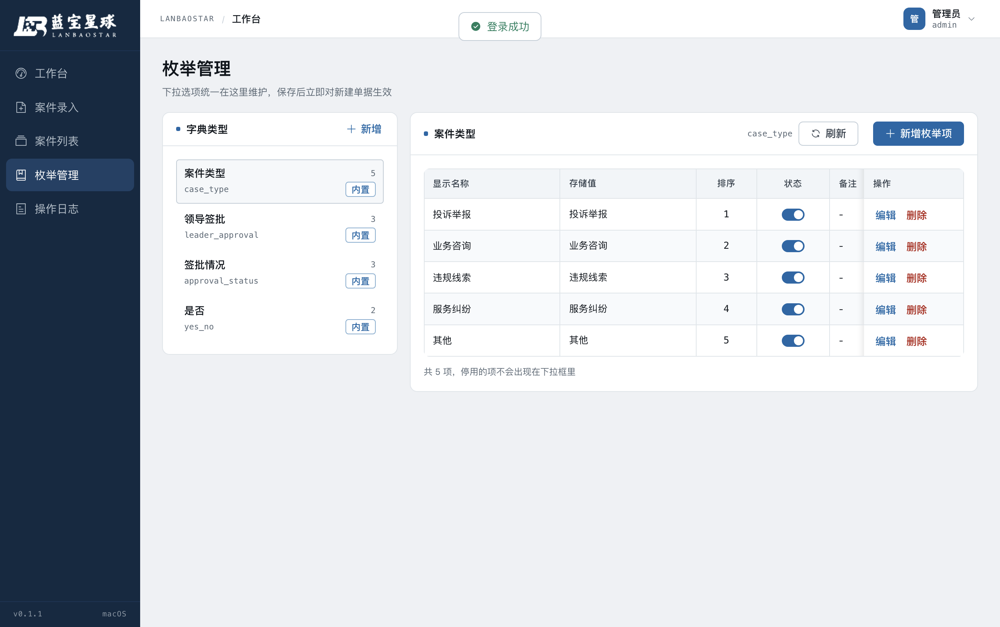

# Mall Desktop

跨平台桌面演示应用（Windows 为主，macOS 同步可用）：**登录 → 案件办理单录入 → 枚举管理 → 操作日志**，数据全部落本机 SQLite，不依赖任何后端服务。

## 界面

| 登录 | 工作台 |
| --- | --- |
|  |  |

| 案件办理单 | 操作日志 |
| --- | --- |
|  |  |

| 枚举管理 |
| --- |
|  |

视觉体系见 [DESIGN.md](DESIGN.md)：港口作业台气质，深水蓝 + 钢灰 + 纸白，发丝线结构，等宽数字，无渐变无阴影。侧栏与登录页使用「蓝宝星球」官方字标（`src/renderer/src/assets/logo-*.png`）。

**自适应**：根字号 `clamp()` + 全局 `rem`，侧栏 `clamp(11.5rem, 14vw, 15rem)`，栅格全部用 `fr` / 百分比；窗口缩小到 64rem 以下侧栏收成图标栏（品牌切 `logo-mark.png`），登录页在 60rem 以下改为顶部品牌条 + 居中表单卡，工作台读数在 46rem 以下折成两列。

## 下载

不装环境直接试用：到 [Releases](https://github.com/jhqxx/mall-windows/releases) 下载最新版本（由 GitHub Actions 在 macOS / Windows 真机上自动构建）。

| 文件 | 用途 |
| --- | --- |
| `MallDesktop-0.1.1-arm64.dmg` | macOS（Apple Silicon），拖进 Applications |
| `MallDesktop.Setup.0.1.1.exe` | Windows 安装包：装到本机、建开始菜单/桌面快捷方式、可在「应用和功能」里卸载 |
| `MallDesktop-0.1.1-portable.exe` | Windows **免安装**：单个 exe，双击即用，不写注册表、不进「应用和功能」，删掉文件就干净 |

免安装版和安装版跑的是同一份代码、同样把数据存在 `%APPDATA%\MallDesktop\`，区别只在「有没有往系统里装东西」。

## 技术栈

| 层 | 选型 | 说明 |
| --- | --- | --- |
| 壳 | Electron 45 | 同一套代码出 `.exe` / `.dmg`，生态最稳 |
| 构建 | electron-vite 6 + Vite 8 | 主进程 / preload / 渲染进程三段式构建，HMR 快 |
| UI | Vue 3 + TypeScript + Element Plus 2.14 | 表单按 Element Plus 分组卡片 1:1 复刻 |
| 数据 | **内置 `node:sqlite`（零原生依赖）**，回退 better-sqlite3 13（N-API 预编译） | 主进程独占；驱动层 `sqlite-driver.ts` 统一接口，运行时自动选择，可用 `MALL_SQLITE_DRIVER=better-sqlite3` 强制回退；两种驱动都**不需要 node-gyp、VS Build Tools、Python** |
| 打包 | electron-builder 26 | mac → dmg(arm64)；win → nsis + portable(x64) |

## 功能

1. **登录**：`admin / 123456`（首次启动自动种子，scrypt 加盐哈希，绝无明文/MD5）。密码错会记一条 `login_failed` 日志；勾选「记住我」后下次启动自动登录（钥匙串可用时用 `safeStorage` 加密，不可用时降级为 600 权限的令牌文件）。
2. **案件录入**：六个分组卡片（案件信息 / 超期信息 / 办案人员 / 签批信息 / 其他信息 / 附件管理）+ 条件校验（超期必填原因、办结时间不晚于今天、审核时间不早于一年前）+ 原生附件多选上传/下载/批量删除。
3. **枚举管理**：左侧字典类型、右侧枚举项的双栏维护页。内置字典（案件类型 / 领导签批 / 签批情况 / 是否）可直接改选项、调排序、启停用；也可以新建自定义字典（编码 + 名称）。**案件录入页的案件类型下拉直接读这张表**，停用某项后新建单据立刻选不到，历史单据不受影响。
4. **操作日志**：时间倒序分页表格，动作筛选 + 关键词搜索 + 导出 CSV，成功/失败用不同颜色 tag 区分（枚举维护同样留痕）。

数据库是 **SQLite**（Electron 45 内置的 `node:sqlite`，回退 better-sqlite3 原生模块），单文件存在应用数据目录：

| 平台 | 数据库文件 | 附件目录 |
| --- | --- | --- |
| macOS | `~/Library/Application Support/MallDesktop/app.db` | 同目录 `attachments/` |
| Windows | `%APPDATA%\MallDesktop\app.db` | 同目录 `attachments\` |

表：`users` / `sessions` / `cases` / `attachments` / `audit_logs` / `dict_types` / `dict_items`。

## 开发

```bash
pnpm install      # 首次：装依赖（无原生编译，不需要 node-gyp / VS Build Tools / Python）
pnpm dev          # 开发模式（HMR）
pnpm build        # 只构建产物到 out/
```

默认账号：`admin / 123456`。

数据位置（卸载应用不会自动清除）：

- macOS：`~/Library/Application Support/MallDesktop/`（`app.db` + `attachments/`）
- Windows：`%APPDATA%\MallDesktop\`

## 打包

### macOS（本机已验证）

```bash
pnpm build:mac
# 产物：release/MallDesktop-0.1.1-arm64.dmg（约 120 MB）
```

### Windows（在 Windows 机器上执行）

前置条件**只需要**：Node.js 20+ 与 pnpm（`npm i -g pnpm`）。
数据层默认走 Electron 内置的 `node:sqlite`（零原生模块），回退用的 better-sqlite3 13 也自带 N-API 预编译产物（`prebuilds/win32-x64.node`），因此**不需要 Visual Studio Build Tools，也不需要 Python**。

```bash
pnpm install
pnpm build:win
# 产物：
#   release/MallDesktop Setup 0.1.1.exe   （NSIS 安装包）
#   release/MallDesktop-0.1.1-portable.exe（免安装单文件）
```

### 用 GitHub Actions 自动打包（推荐）

`.github/workflows/build.yml` 会在 **macOS 与 Windows 真机上并行构建**，两条命令都不用你自己开机器：

```bash
git push origin master            # 每次推送：构建两个平台，产物留在 Actions 的 Artifacts 里
git tag v0.1.1 && git push origin v0.1.1   # 打 tag：额外把 dmg + exe 挂到 GitHub Release
```

也可以在仓库的 **Actions → build → Run workflow** 手动触发。Artifacts 里的 `mac-arm64` / `win-x64` 是两个平台打好的包（保留 90 天）。

### 安装包未签名

- macOS：首次打开被 Gatekeeper 拦住时，**右键 dmg 里的 MallDesktop → 打开**，或到「系统设置 → 隐私与安全性」点「仍要打开」。
- Windows：SmartScreen 提示「Windows 已保护你的电脑」时，点「更多信息 → 仍要运行」。

## 目录结构

```
src/main/       主进程：窗口、单实例锁、数据层（db.ts + sqlite-driver.ts）、密码哈希（auth.ts）、IPC 注册（ipc.ts）
src/preload/    contextBridge 白名单 API（contextIsolation: true / nodeIntegration: false）
src/renderer/   Vue 3 界面：登录、工作台、案件录入、案件列表、枚举管理、操作日志
scripts/        electron-builder afterPack 钩子（裁掉非当前平台的预编译 .node）
```

## 安全边界

- 渲染进程不碰 Node：只通过 preload 暴露的白名单 IPC 访问数据层。
- 数据库只由主进程打开（WAL + busy_timeout=5000），schema 用 `schema_version` 顺序迁移，不上 ORM。
- 附件实体存 `userData/attachments/<uuid>_<原名>`，库里只存元数据。
